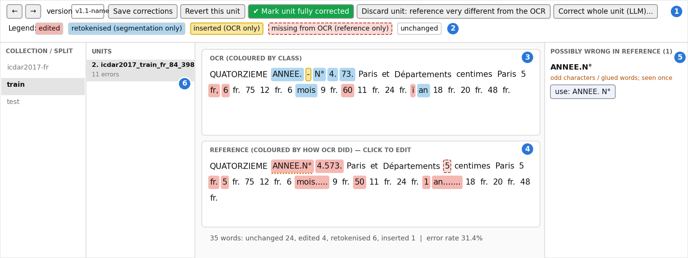

# Annotating the reference transcriptions

We are correcting errors in the reference transcriptions of the splits in this repository, with the browser viewer `viewers/ocr_word_labels_viewer.html`.

## Who annotates what

Two annotators, split by language so that nobody works on the same units:

| Annotator | Collections (viewer names) | Units |
|---|---|---|
| Emanuela | `icdar2017-fr`, `icdar2019-fr`, `impresso-snippets-fr` | 3,500 (all splits) |
| Wenjun | `icdar2017-en`, `icdar2019-en`, `impresso-snippets-en`, `overproof-combined-en` | 1,308 (all splits) |

Do only your own collections. `icdar2019-fr` is 2,849 units, most of the French share; if it needs to be shared, agree on unit ranges by hand (for example "units 1-1400 are Emanuela's") before starting. Each annotator saves a corrections file per session and commits it to `corrections/` (section 5); because the collections are disjoint, the two annotators' files can be merged without conflicts.

## How to annotate

We check and correct the **reference** (ground-truth) transcription of each unit, using the OCR text next to it. Use the table above to see which collections are yours.

## 1. Start the viewer

```bash
git clone https://github.com/EmanuelaBoros/ocrepair-data.git
cd ocrepair-data/viewers
python3 -m http.server 8000
```

Open <http://localhost:8000/ocr_word_labels_viewer.html> in your browser. Use the same browser every time: your edits and marks are kept in its local storage, and clearing the browser data deletes them. Nothing is uploaded; the page has no server. If you pulled a new version of the repository, restart the server and reload the page.

## 2. What you see



*Illustration drawn from a real unit (`icdar2017_train_fr_84_398`) with the viewer's colours; the real page looks the same but is not a screenshot.*

1. **Buttons** (top): previous / next unit, the version name, **Save corrections**, **Revert this unit**, **Mark unit fully corrected**, **Discard unit** and **Correct whole unit (LLM)**. Below them a progress bar per collection (not shown) counts the units marked fully corrected; click it to jump there.
2. **Colour legend.** Words are coloured by how the OCR relates to the reference:

   | Colour | Meaning | What it tells you |
   |---|---|---|
   | white | unchanged | OCR and reference agree |
   | red | edited | the OCR word differs from the reference word (an OCR error, or a mistake in the reference) |
   | blue | retokenised | same letters, but the OCR split or merged the word differently (`advertise ments` / `advertisements`) |
   | yellow, solid outline | inserted | a word that only the OCR has (shown in the OCR panel) |
   | pink, dashed outline | missing from OCR | a word that only the reference has (shown in the reference panel) |
   | orange dotted underline | suspicious | the word in the reference may itself be wrong; it is also listed on the right |

   "Dim unchanged words" (checkbox) fades the white words so that only the differences stand out. A red mark does not mean the reference is wrong: in most units the OCR is the wrong side. You are looking for the cases where the **reference** is wrong.
3. **OCR panel:** the OCR text, coloured as above.
4. **Reference panel:** the reference text, coloured by how the OCR did. Click in it to edit. Once you edit a unit the colours disappear and the unit is marked as edited in the list.
5. **"Possibly wrong in reference" (right):** words of the reference that look suspicious, with the reason (odd characters or glued words; one letter from a common word; seen only once) and, when there is one, a suggested replacement (`use: ...`). Clicking an entry jumps to the word in the reference. For some units it also lists proposals from an earlier LLM review, with a reason and a confidence.
6. **Units list:** the units of the selected split with the number of errors. A unit you marked fully corrected has a green bar, an edited one an orange bar, a discarded one a red bar.

Example: in the unit above the OCR has `ANNEE. - N° 4. 73.` where the reference has `ANNEE.N° 4.573.`. The blue words are the OCR splitting the reference differently, the red `73.` against `4.573.` is an OCR error, and `ANNEE.N°` is underlined in orange because it looks like two words glued together: the suggestion on the right is `ANNEE. N°`. You decide whether that is a mistake of the reference.

## 3. What to correct

Fix only clear, certain errors in the **reference** text: a typo, a swapped or missing letter, a missing space after punctuation. Be conservative; if you are not sure, leave it.

- Do not add or delete words.
- Do not modernise or normalise: keep historical spellings, archaic and dialect forms, long s, ligatures, diacritics, capitalisation, abbreviations and the punctuation habits of the period, even where they look wrong today.
- Do not add or change quotation marks.
- Do not change numbers, names or dates unless the OCR text clearly shows that the reference has a typo.
- Do not touch other line breaks or hyphenation (see the exception below).

**Exception, ICDAR collections (`icdar2017-*`, `icdar2019-*`):** in the reference, a line break sometimes falls in the middle of a word (for example `exam` + line break + `ple`). Remove the line break so that the word is whole (`example`). Delete only the line break (do not add a space or a hyphen); a line break between two words stays as it is. If the break splits a word together with a hyphen, do not decide it yourself: leave it and note the unit, so that we can agree on one rule.

## 4. How to work on a unit, step by step

For every unit in your collections:

1. **Select the unit** in the units list and read the OCR panel and the reference panel. Turn on "dim unchanged words" to see the differences. Ask yourself, for each coloured word: is the **reference** right? Usually it is, and the OCR is the one that is wrong; then there is nothing to do.
2. **Correct the reference where it is wrong**, in one of three ways (you can mix them in the same unit):
   - **By hand.** Click in the reference panel and fix the text (a typo, a swapped or missing letter, a missing space after punctuation, a line break in the middle of an ICDAR word). The unit shows as edited. "Revert this unit" undoes all your edits of the unit.
   - **With the suggestions on the right.** Click an entry to jump to the word in the reference, check it against the OCR, and if the suggestion is right, click `use: ...` to apply it. If it is not right, ignore it; nothing changes until you click.
   - **With an LLM.** Press **Correct whole unit (LLM)...** and fill in the model id, the effort and your OpenAI API key (kept for this tab only). **Propose correction** shows the current reference next to the proposed one, with the changes listed; you can edit the proposal, then press **Yes, use this text** or **No, discard**. **Judge: is the text correct?** only asks the model for a verdict and changes nothing. The LLM can be wrong: always compare its changes with the OCR, and apply the same rules as in section 3.
3. **When you have checked the whole unit, press Mark unit fully corrected** (press again to undo), also when you changed nothing, so that progress is counted. Go on with the next unit (the arrow button).
4. **If the reference is not the text of the OCR at all** (wrong page or passage), press **Discard unit: reference very different from the OCR** (red) instead of correcting. Do not use it for a reference with a few errors. The unit gets a red bar and "discarded"; press again to undo. Nothing is deleted: the flag is saved in your corrections file, and the unit is then flagged or removed when the files are applied (section 6). Do not edit a discarded unit.
5. **Save regularly** (section 5).

## 5. Save and share your work

1. Set the **version** field at the top to `v1.1-<your name>` (for example `v1.1-emanuela`, `v1.1-wenjun`).
2. Press **Save corrections**. The browser downloads `hipe-ocrepair-bench_v1.1-<your name>_ref-corrections.json`, which holds your edited references, the units you marked fully corrected and the units you discarded.
3. Do this at the end of every session (it contains all of your work so far, not only the last session) and commit the file to the `corrections/` folder of this repository, by pull request or directly if you have write access. A newer file replaces your older one.

Because the two annotators work on different collections, the files can be merged without conflicts: the merged result is the union of the `edits` and `corrected` entries of both files.

## 6. For the maintainers: applying the files

```bash
python3 viewers/apply_ref_corrections.py corrections/<file>.json [--drop-discarded]
```

writes the corrected files to `data/<version>/`. Edited units get the new reference; units marked fully corrected get `manually_corrected: true`. Discarded units get `discarded: true` in `document_metadata` (their edits are ignored), or are left out of the new files with `--drop-discarded`.
